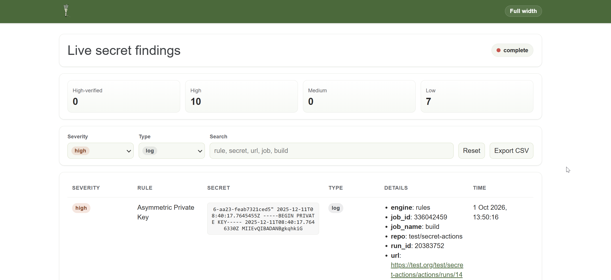

# Credentials Scanning in GitLab Pipelines

> This example focuses on GitLab, but Pipeleek also supports other platforms. Refer to the documentation for details on additional integrations.

Suppose you're conducting a penetration test and have access to a GitLab instance with a user account. Your goal is to scan the pipelines for exposed secrets and credentials.

Start by creating a personal access token (`Menu` → `Preferences` → `Access Tokens`) and grant it read access scopes. Additionally, use your browser's developer tools to extract the session cookie (`_gitlab_session`).

For an initial scan, target all repositories you can access, including public ones. To keep the scan fast and broad, limit it to the latest 15 jobs per project:

```bash
pipeleek gl scan -u https://gitlab.com -t glpat-[redacted] --cookie [redacted] --artifacts --job-limit 15
2025-09-30T09:53:30Z info Gitlab Version Check revision=f0455ea9f90 version=18.5.0-pre
2025-09-30T09:53:30Z info Fetching projects
2025-09-30T09:53:30Z info Provided GitLab session cookie is valid
2025-09-30T09:53:33Z hit SECRET confidence=low type=log jobName=archives-job ruleName=api_key url=gitlab.com/testgroup/project/-/jobs/11484162851 value="m$ mkdir archive_data $ echo \"datadog_api_key=secrets.txt file hit\" > archive_data/secrets_in_ar"
2025-09-30T09:53:36Z hit SECRET confidence=high type=log ruleName="Generic - 1719" url=gitlab.com/testgroup/project/-/jobs/11484162842 value="datadog_api_key=dotenv ONLY file hit, no other artifacts "
2025-09-30T09:53:37Z hit SECRET confidence=high type=artifact file=an_artifact.txt jobName=artifact-job ruleName="Generic - 1719" url=gitlab.com/testgroup/project/-/jobs/11484162833 value="datadog_api_key=secret_artifact_value "
```

Findings use the `hit` log level. The sample output above uses additional YAML rules; your findings depend on the rules and credentials present. Review non-verified hits manually, or use `--confidence=verified` to show only successfully verified credentials. See [detection, verification, and rules](../introduction/secrets_verification.md) for reporting behavior and optional rule downloads.

Job-log (`type=log`) and artifact (`type=archive`) findings link to the job. Findings labeled `.gitlab-ci.yml` use `type=cicd-yaml` and link to that file on the default branch. The scanned content is GitLab's merged CI configuration, so a match may originate from an included file.

### Live Findings Web UI

Add `--webui` to serve findings in a live web UI while the scan runs. Pipeleek binds the UI to `127.0.0.1` on an available local port and prints a URL with a random access token. The UI is only reachable from the local machine by default. Open the printed URL in a browser to watch findings arrive, filter and search them, and export them as CSV. Results remain available after the scan completes, and the command keeps serving the UI until you press Ctrl+C. The URL grants access to scan findings; treat it as sensitive and redact its token before sharing logs.

Below **Live secret findings**, the UI shows the target instance and effective scan flags, including values from configuration and defaults. Credential values such as tokens and cookies are redacted, and credentials, query parameters, and fragments in the target URL are omitted.

Use `-v` with `--webui` to see debug-level startup details:

```bash
pipeleek gl scan -u https://gitlab.com -t glpat-[redacted] --cookie [redacted] --artifacts --job-limit 15 -v --webui
2026-10-01T11:50:13Z debug Log level set to debug (-v)
2026-10-01T11:50:13Z debug Searching for config file in standard locations
2026-10-01T11:50:13Z info Loaded config file file=/home/user/.config/pipeleek/pipeleek.yaml
2026-10-01T11:50:13Z info Findings web UI started token=[redacted] url=http://127.0.0.1:42957/?token=[redacted]
2026-10-01T11:50:13Z debug Loaded embedded and local rules count=15
```

The `Findings web UI started` message appears near the start of the scan. Use the URL from your own run; its port and token are generated dynamically.



If you find a repository that looks particularly interesting e.g. `secret-pipelines`, you can scan all its job logs, not just the most recent ones:

```bash
pipeleek gl scan -u https://gitlab.com -t glpat-[redacted] --cookie [redacted] --artifacts --repo mygroup/my-secret-pipelines-project
```
